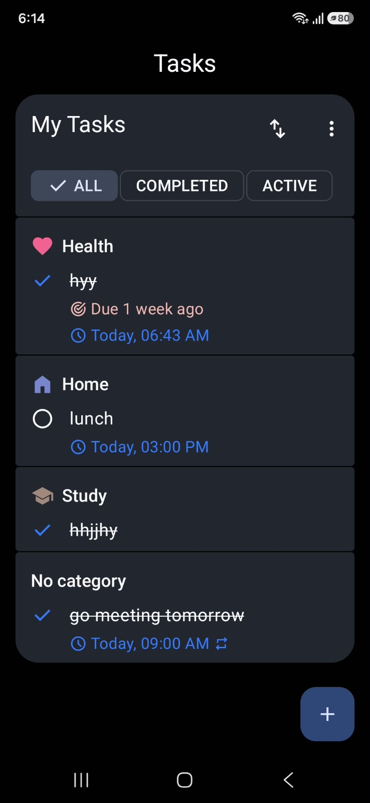
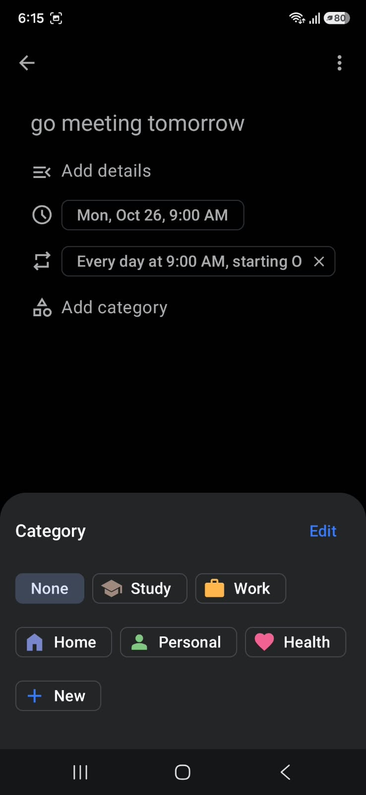
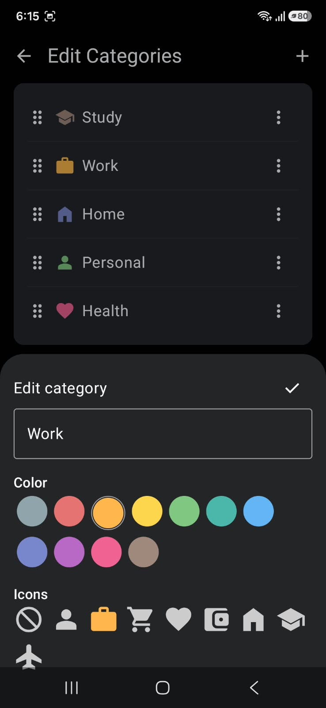

# Todo App

A modern Android task management app built with **Kotlin and Jetpack Compose**, designed to help you organize daily tasks, manage routines, and stay on top of your responsibilities.

## Features

- **Task Management** — Create, edit, and complete tasks with optional details.
- **Categories** — Organize tasks into customizable categories with colors and icons.
- **Flexible Sorting** — Arrange tasks according to your preferred order.
- **Task Filtering** — Filter tasks by all, active, or completed status.
- **Reminders** — Schedule notifications to help you remember important tasks.
- **Recurring Tasks** — Set tasks to repeat on a schedule, such as every day.
- **Custom Ordering** — Reorder categories and tasks to suit your workflow.
- **Dark Theme** — A dark interface with a clean, Material-inspired design.

## Tech Stack

- **Language:** Kotlin
- **UI:** Jetpack Compose
- **Architecture:** ViewModel and Repository pattern
- **Database:** Room
- **Dependency Injection:** Hilt

## Screenshots

Explore the screenshots below to see task management, task details, recurring tasks, and category customization in action.

### Task Management

<table>
  <tr>
    <td align="center" width="33%">
      <b>Task List</b>  
      
    </td>
    <td align="center" width="33%">
      <b>Completed Tasks</b>  
      
    </td>
    <td align="center" width="33%">
      <b>Task Details</b>  
      
    </td>
  </tr>
</table>

### Category Management

<table>
  <tr>
    <td align="center" width="50%">
      <b>Category Selection</b>  
      
    </td>
    <td align="center" width="50%">
      <b>Edit Categories</b>  
      
    </td>
  </tr>
</table>
